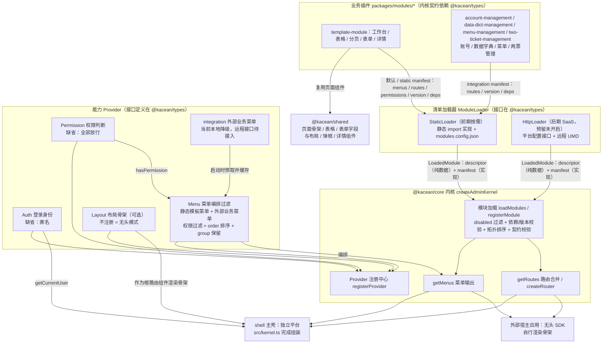
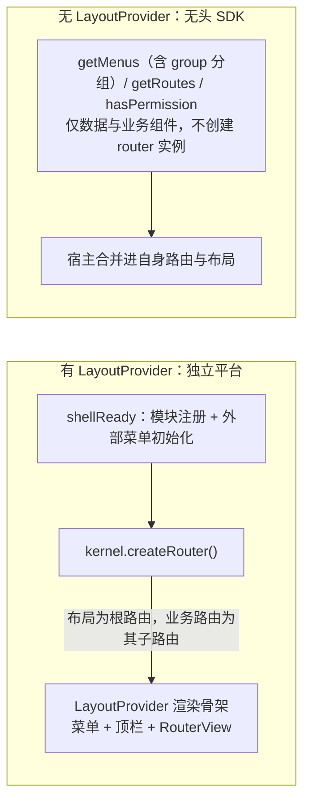

# kacean-admin

基于 pnpm monorepo 的后台管理系统：**shell 主壳 + 业务模块（modules）+ 公共包**。

## 环境要求

- Node.js >= 20
- pnpm 10.34.9（已由根 `package.json` 的 `packageManager` 锁定，推荐用 corepack 启用）

## 快速开始

```bash
pnpm install        # 根目录安装全部依赖
pnpm dev:shell      # 开发主壳应用
```

## 目录结构

```
.agents/skills/kacean-template-module/ # 项目级模板页开发 Skill 与共享组件参考
packages/
├─ shell/              # 主壳应用（Vue 3 TSX + TDesign + UnoCSS，独立平台组装层）
├─ core/               # 内核 @kacean/core：模块加载、契约校验、Provider 注册中心（Auth/Permission/Menu/Layout）
├─ admin-module-types/ # 共享 TypeScript 类型定义（包名 @kacean/types）
├─ common/             # 共享通用逻辑（工具函数、常量、HTTP 请求封装等，无 UI）
├─ shared-components/  # 共享 UI 组件
└─ modules/            # 业务插件模块：每一个文件夹都是一个独立模块
   ├─ account-management/    # 账号管理：登录账号查询、新增、编辑与删除（login-account 接口）
   ├─ data-dict-management/  # 数据字典管理：字典本地过滤分页，overlay 面板管理字典值（data-dict / data-dict-value 接口）
   ├─ menu-management/       # 菜单管理：静态菜单配置列表
   ├─ template-module/       # 静态工作台与模板展示：表格、分页、分步/分块表单、日期、弹框与详情布局
   ├─ two-ticket-management/ # 两票管理：工作票与操作票静态列表
   └─ <模块名>/              # 可独立开发、独立构建
scripts/                # 工程化脚本：模块命令转发、工作区约束检查
```

- 主壳与公共包：`packages/` 下固定为 `shell`、`core`、`admin-module-types`、`common`、`shared-components`。
- 业务模块：只放 `packages/modules/` 下，模块间互不依赖，共享能力使用公共包（`workspace:*`）。
- 当前新增 `account-management`、`data-dict-management`、`menu-management`、`two-ticket-management`，均可通过 `pnpm dev:module <模块名>` 独立开发、通过 `pnpm build:module <模块名>` 生成 ESM / UMD 双产物；`account-management` 已接入 login-account 后端接口（查询、新增、编辑、删除），`data-dict-management` 已接入 data-dict / data-dict-value 接口（字典查询、新增、编辑、删除与 overlay 面板内字典值管理，因后端 page 的 total/pageNum 未生效且 keyword 不过滤，由视图本地过滤分页），`two-ticket-management` 的两票类型管理已接入 ticket-type 接口，其余页面仍使用本地静态数据。账号、数据字典与两票同属一个后端服务，复用 shell 服务目录中的 `two-ticket` 服务 key。

## 共享页面组件与模板 Skill

`@kacean/shared` 提供模板页和业务页面可复用的页面骨架、组合组件、轻量表单字段与弹框，`template-module` 负责演示这些组件的实际组合方式：

- 页面：`PageHeader`、`PageContainer`、`SectionCard`。
- 表格与分页：`DataTable`、`PaginationBar`、`PaginatedTable`、`DataTableTemplate`。其中 `PaginatedTable` 使用受控页码和当前页数据，既支持本地切片，也支持调用方接入接口分页；`DataTableTemplate` 组合统一页头、上方查询条件区、下方列表区域与底部分页，占满 main 可用高度，仅表格内容区滚动。
- 树：`AppTree`，封装 TDesign Tree，必需 `data`，默认 `hover`；透传勾选 / 激活 / 展开 v-model 及 `keys`、`filter`、`load` 等能力，过滤与懒加载逻辑由页面管理。
- 表单布局：`FormGrid`、`FormActions`、`StepFormLayout`，字段校验和步骤状态由页面管理。
- 表单字段：`FormInput`、`FormTextarea`、`FormSelect`、`FormDatePicker`、`FormDateRangePicker`、`FormDatePickerPanel`、`FormDateRangePickerPanel`、`FormCalendar`、`FormRadioGroup`、`FormCheckboxGroup`、`FormSwitch`、`FormUpload`，透传 TDesign props；日期选择组件支持 `v-model`，Calendar 通过 `value` / `onCellClick` 管理选中值，上传请求由使用方配置。
- 弹框：`AppDialog`、`ConfirmDialog`、`AppDrawer`，支持 `v-model:visible`；`AppDrawer` 复用 `SidePanel` 的 overlay 形态（滑入滑出过渡，`mask={false}` 可无遮罩），业务确认逻辑由页面管理。
- 详情：`DetailSummary`、`DetailGrid`、`SidePanel`，支持自定义摘要内容、主侧栏响应式布局以及 dock / overlay 右侧面板。

模板页开发使用项目级 Skill [`.agents/skills/kacean-template-module/SKILL.md`](./.agents/skills/kacean-template-module/SKILL.md)，组件契约见其 `references/shared-components.md`。Pi 新会话会发现项目 Skill，当前会话新增或修改后需执行 `/reload`；也可通过 `/skill:kacean-template-module` 显式加载。

## 内核与两种运行形态

### 架构图



### 两种形态的数据流



内核 `createAdminKernel()`（`@kacean/core`）负责模块加载、契约校验与 Provider 注册中心：

- `auth`：登录身份（缺省匿名）；`permission`：权限判断（缺省放行）；`menu`：菜单编排过滤（缺省内置实现，可聚合宿主预取的外部菜单）；`layout`：布局骨架（可选）。
- **菜单与权限来源**：真实业务模块 manifest 只提供 `routes` 等模块元数据；`template-module` 保留静态演示 `menus` 与权限声明。默认 / static 只挂载模板模块，不加载外部业务菜单；integration 只挂载真实业务模块，其菜单暂由 shell `src/providers/menu.ts` 提供本地降级数据。`src/providers/permission.ts` 默认全部放行，真实菜单、权限接口尚未接入。`main.ts` 等待 `shellReady` 完成模块注册和菜单初始化后再创建 Router，确保首页能取到第一条可见菜单。动态菜单过滤不代表路由访问鉴权，直接 URL 守卫需单独实现。
- **独立平台**：shell 注册 TDesign `LayoutProvider`（`packages/shell/src/providers/TDesignLayout.tsx`），`kernel.createRouter()` 以布局为根路由。默认布局提供品牌主题（默认 / 能源蓝 / 国网绿 / 活力橙）、浅色 / 深色 / 跟随系统主题、侧边 / 顶部导航切换和沉浸模式，偏好保存在浏览器 `localStorage`；这些显示能力仅属于 shell，不改变内核与无头模式契约。侧栏顶层菜单按 `group` 分组展示（工作台、两票管理与模板演示归「操作空间」，账号与菜单管理归「系统管理」，shell 不预置系统管理占位菜单），顶栏设置按钮旁提供沉浸模式快捷入口，沉浸模式右上角操作区默认收起，鼠标悬停、键盘聚焦或点击后展开，`Esc` 可退出。
- **无头 SDK**：不注册 `layout`，宿主仅消费 `getMenus()` / `getRoutes()` / `hasPermission()` / 业务组件，自行渲染骨架。

**全局右侧面板（可选注入契约，不属于内核 Provider）**：共享组件 `SidePanel`（`@kacean/shared`）提供 dock（推挤 + 收缩把手条）与 overlay（抽屉，带滑入滑出过渡，`mask=false` 无遮罩）两种形态，可通过 `showClose` / `showCollapse` 分别隐藏关闭与收缩按钮；shell 的 `providers/globalPanel.tsx` 组合同一组件作为全局面板（宽度与收缩状态持久化，路由切换默认关闭，窄屏自动 overlay）。模块通过 `PANEL_CONTROLLER_KEY`（`@kacean/common`）以 `inject` 获取 `PanelController`（类型在 `@kacean/types`），以「组件 + props」打开面板；未注入（模块独立开发、无头宿主未实现）时必须用本地 `SidePanel` 降级，宿主也可自行 provide 同接口实现。演示见 template-module 详情布局页。

**HTTP 请求层（`@kacean/common`，零依赖 fetch 封装）**：数据契约在 `@kacean/types` 对齐后端——`ApiResponse<T>` 对应 `Result<T>`（成功码固定 `'0'`，参数校验失败为 `'VALIDATION_ERROR'`，common 提供 `SUCCESS_CODE` / `isSuccessResponse` / `isValidationErrorResponse`）；`PageQuery<Q>` / `PageResult<T>` / `Query` / `Sort` 对应后端分页模型（`query` + `pageNum` + `pageSize`，响应为 `records` + `total`），common 提供 `DEFAULT_PAGE_SIZE` / `MAX_PAGE_SIZE = 200` / `calcTotalPages`。模块在自身 `src/api/` 声明依赖的**逻辑服务 key**（单模块可多个，同一服务跨模块复用同一 key，跨服务用不同 key），通过工厂的 `createForService(service)` 获取 client；**baseURL 唯一配置来源是 shell `src/services.config.ts` 服务目录**（按环境配置，未登记的服务 key 会抛错），`create(baseURL)` 字面量方式仅作临时地址兜底；鉴权通过 `HttpAuthProvider` 抽象统一注入（具体 Bearer / Cookie 等方式待确认后由 shell 实现，缺省匿名），与内核 `AuthProvider`（登录身份）职责分离。shell / 宿主可用 `createHttpClientFactory` 配置统一鉴权后经 `HTTP_CLIENT_FACTORY_KEY` provide，模块以 `inject(HTTP_CLIENT_FACTORY_KEY, undefined) ?? defaultHttpClientFactory` 获取工厂（可选注入，与面板同模式）。shell 已在 `src/providers/http.ts` 提供**鉴权空实现**（`createEmptyHttpAuthProvider`：不附加鉴权头，token 存取 / 刷新 / 401 行为均为 TODO 待确认）并在 `main.ts` 统一 provide 工厂，后续只需替换该文件内的鉴权实现。`request<T>` 默认拆包返回 `data`、业务失败抛 `HttpError`（含 `code` / `data`），`requestResult<T>` 返回完整 `ApiResponse`；确认后端接口直接返回未包裹 JSON 时，可显式传 `responseFormat: 'raw'`；仅在已确认部署间存在包装差异时使用 `'auto'` 兼容有无 `Result`（有包装仍校验业务码），并可用 `parseJson` 在解析阶段将 int64 ID 转为字符串（默认 Result 校验不变）；支持 `get/post/put/patch/delete`、query 序列化、超时与 `AbortSignal` 取消。模块接入的完整流程与代码范例见 `.agents/skills/kacean-module-http/SKILL.md`。

### 清单加载：前期按需，后期 SaaS（同一套内核）

**清单描述与模块实现分离**：`ModuleDescriptor` 是可 JSON 序列化的纯数据（`id` / `version` / `disabled` / `order` / `entry` / `integrity` / `global`），`AdminModuleManifest` 是含组件代码的实现；loader 输出 `LoadedModule = { descriptor, manifest }`，内核 `loadModules(loader)` 统一执行 disabled 过滤、依赖与版本校验、依赖拓扑排序（平级按 `order`）与契约校验。`menus` 为可选静态菜单，真实业务模块可只提供 `routes`；静态菜单在模块注册时校验，外部动态菜单由 shell 初始化时整理，未注册或已停用模块的叶子菜单会过滤并告警。

- **前期按需模式（当前）**：core 的 `createStaticModuleLoader`，模块实现构建期显式 import（按需打包、tree-shake），shell `src/modules.config.json` 配置启停与注册顺序；产物可控、可离线部署。
- **后期 SaaS 模式（预留）**：仅以 `HttpLoader` 替换清单来源（平台配置接口 + 远程 UMD 加载，支持租户开关与版本灰度），注册编排、契约校验、无头能力完全复用。**远程 UMD 动态加载分支当前未实现、未开启**；运行时热卸载（unregister 与副作用回收）同为预留演进点。
- **版本与依赖**：manifest 必含 `version`（与模块 package.json 同步），`deps` 声明模块依赖及版本范围（仅支持 `^` / `~` / 精确 / `*`，core 内置轻量匹配）；descriptor.version 与实现版本不一致时注册失败。
- **远程元数据**：模块 `build` 除 ESM / UMD 双产物外，还生成 `dist/manifest.json`（`id` / `version` / `entry` / `integrity` / `global`，含 UMD 的 SRI 校验值），即后期 HttpLoader 的元数据格式，静态模式不消费。

## 主题与 token

统一使用 TDesign token（`--td-*` CSS 变量），不另建自有 token 层——WC / UMD 嵌入下模块与宿主运行时本就分割，需要统一的只是视觉主题：

- **独立平台**：在 shell `src/styles/theme.css` 集中覆盖 `--td-*` 定制品牌主题；默认布局通过根节点 `data-brand-theme` 切换品牌配色（`default` / `energy-blue` / `sgcc-green` / `vibrant-orange`），通过 `theme-mode` 切换 TDesign 明暗主题，两者正交组合。
- **无头嵌入**：宿主在自身样式表覆盖同名 `--td-*` 变量即可。CSS 自定义属性沿 DOM 继承，UMD 普通挂载直接生效；WC + Shadow DOM 下变量可穿透继承（模块样式表需注入 shadow root）；暗色模式由宿主同步挂载容器的 `theme-mode` 属性。
- **业务模块**：自定义样式只引用 `--td-*` 或 UnoCSS 语义原子类（`text-primary` / `bg-page` / `text-secondary` 等，见 `uno.config.ts` 的 theme 映射），禁止硬编码色值，保证宿主覆盖变量后整体跟随。

## 常用命令

| 命令                         | 说明                                                 |
| ---------------------------- | ---------------------------------------------------- |
| `pnpm dev:shell`             | 开发主壳（默认静态数据）                             |
| `pnpm dev:shell:integration` | 开发主壳（联调模式，不加载 template-module）         |
| `pnpm build:shell`           | 构建主壳（默认静态数据）                             |
| `pnpm build:static`          | 构建所有已配置 `build:static` 的包，加载静态模板模块 |
| `pnpm build:integration`     | 构建联调包，不加载 template-module                   |
| `pnpm dev:module <模块名>`   | 开发指定模块                                         |
| `pnpm build:module <模块名>` | 构建指定模块                                         |
| `pnpm build`                 | 构建所有已配置 `build` 的包                          |
| `pnpm typecheck`             | 执行所有已配置的类型检查                             |
| `pnpm check:workspace`       | 检查包名、依赖协议与方向、模块脚本及 shell 清单依赖  |
| `pnpm check`                 | 工作区约束 + 全仓 lint + 类型检查                    |
| `pnpm verify`                | `check` + 全仓构建                                   |
| `pnpm lint`                  | 全仓 lint                                            |
| `pnpm format:check`          | 全仓格式只读检查                                     |
| `pnpm format`                | 全仓格式化（写入文件）                               |

公共包以源码直出，不强制提供 `dev` / `build`，递归命令通过 `--if-present` 跳过未配置脚本。`check:workspace` 只使用 Node.js 内置模块，不新增依赖。`verify` 不包含格式检查、未配置的单元测试或浏览器走查；这些项目需按实际任务单独执行并汇报。

## static 与 integration 的模块挂载边界

`template-module` 始终是纯静态示例模块，只使用本地 mock，不读取数据源环境变量，也不包含后端请求。shell 根据 Vite mode 互斥挂载模块：默认模式和 `static` 模式只导入、注册 `template-module`；`integration` 模式只导入、注册真实业务模块，不加载模板模块。账号、菜单、两票管理及后续新增业务模块都只在 integration 挂载，仍可独立开发、独立构建。

| 模式          | template-module                      | 完整平台启动命令             | 完整平台构建命令         |
| ------------- | ------------------------------------ | ---------------------------- | ------------------------ |
| 默认 / static | 加载；本地筛选、分页和其他静态交互   | `pnpm dev:shell`             | `pnpm build:static`      |
| integration   | 不导入、不注册，不显示模板菜单与路由 | `pnpm dev:shell:integration` | `pnpm build:integration` |

以下命令都在**仓库根目录**执行。首次使用或依赖发生变化时先执行 `pnpm install`，启动后打开终端中 Vite 输出的地址。

### 方式一：纯静态 mock（不需要后端）

#### 1. 启动完整平台

```bash
pnpm install
pnpm dev:shell
```

如果只想开发模板模块，不启动 shell，可以执行：

```bash
pnpm dev:module template-module
```

两种启动方式都不会请求分页接口。shell 在默认 / static 模式不会导入、注册真实业务模块，也不会加载其本地降级菜单。静态模式的「数据表格模板」路由为 `/template-module/table-pagination`，使用 `src/data/projects.ts` 本地过滤和切片。默认的 `pnpm dev:shell`、`pnpm dev:module template-module` 和 `pnpm build` 都会加载静态模板模块。

#### 2. 构建静态产物

```bash
pnpm build:static
```

该命令会构建 shell 和 template-module：

- `packages/shell/dist`：可部署的完整平台静态文件，部署到 Nginx 等 Web 服务器即可。
- `packages/modules/template-module/dist`：模块的 ESM / UMD 库产物及 `manifest.json`，不是可直接打开的独立网站。

只需要其中一个产物时，可分别执行：

```bash
pnpm --filter shell build:static
pnpm --filter template-module build:static
```

### 方式二：前后端联调（排除模板模块）

#### 1. 启动联调主壳

```bash
pnpm dev:shell:integration
```

该命令以 `integration` mode 启动 shell。`packages/shell/src/modules.ts` 不会执行 `template-module` 的动态导入，清单中也会排除模板描述，因此不会注册包括工作台在内的模板菜单或路由。integration 模式只显示清单中保留的业务模块；当前会加载账号管理、菜单管理和两票管理，其中账号管理已接入 login-account 接口、两票类型管理已接入 ticket-type 接口，其余页面仍使用本地静态数据。菜单暂由 shell 本地降级 Provider 提供，权限默认全部放行，尚未请求真实菜单或权限接口。后续接入后端时，各模块按自身接口配置联调，shell 再逐步替换菜单与权限数据源。

模板模块不提供 `dev:integration`，也不要在模板页面中判断 `integration` 或添加 mock / 接口分支。真实业务模块的 HTTP 接入方式见 `.agents/skills/kacean-module-http/SKILL.md`，服务 baseURL 统一在 shell `src/services.config.ts` 登记。

#### 2. 构建联调产物

```bash
pnpm build:integration
```

当前只有 shell 配置了 `build:integration`，所以该命令只更新 `packages/shell/dist`，不会构建或打包模板模块。只需要主壳时也可以直接执行：

```bash
pnpm --filter shell build:integration
```

静态与联调构建都会覆盖 `packages/shell/dist`，发布前应重新执行目标模式的构建命令。构建成功只代表编译通过，不代表实际业务模块的后端接口已经连通。

模板静态工作台、菜单、`group` 与菜单权限声明集中在 `packages/modules/template-module/src/menus.ts` 和 `src/manifest.ts` 维护；真实业务模块 manifest 只提供路由，shell 在 `src/providers/menu.ts` 维护可替换的外部菜单接入点。shell 不再维护内置静态页面 manifest，用户、组织与系统设置占位页已移除。

## 协作规范

人类与 AI agent 共用同一套规范，见 [AGENTS.md](./AGENTS.md)。
