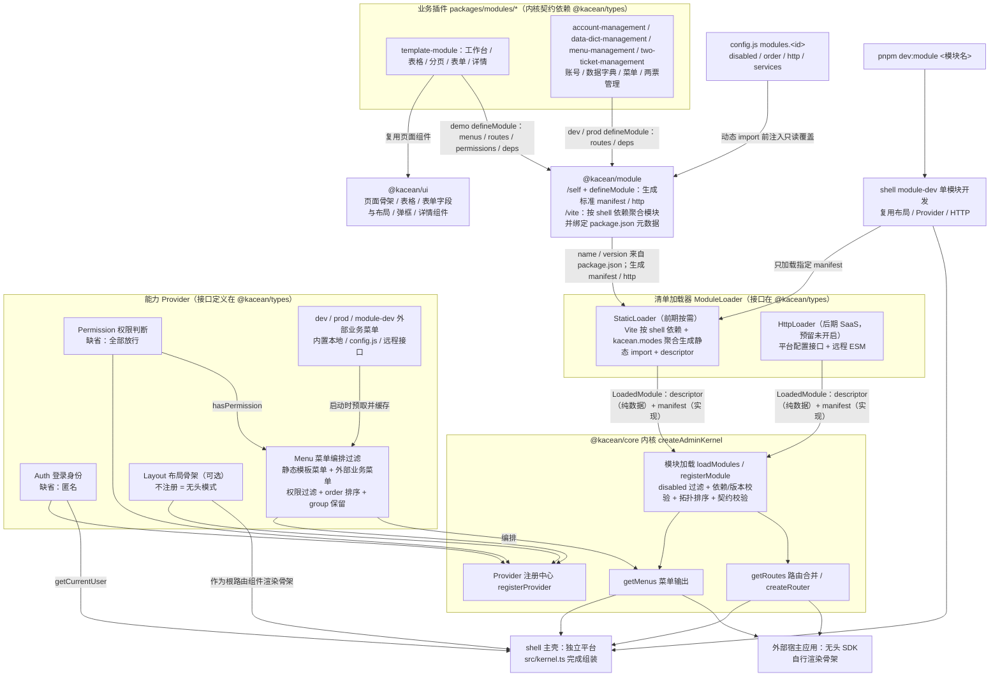
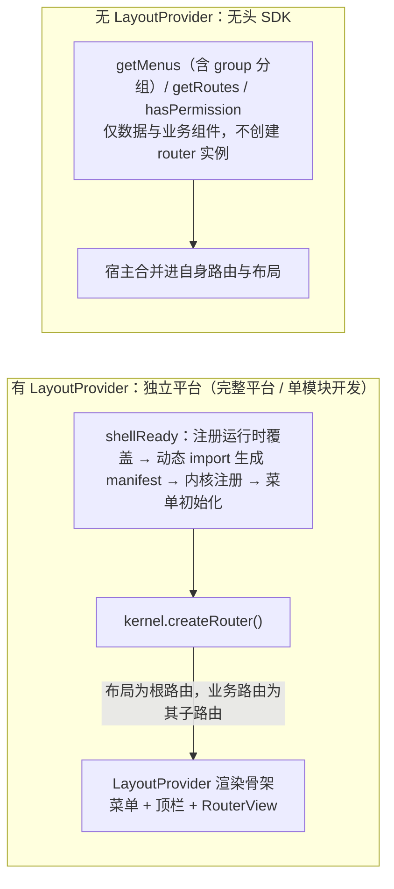

# kacean-admin

基于 pnpm monorepo 的后台管理系统：**shell 主壳 + 业务模块（modules）+ 公共包**。

## 环境要求

- Node.js >= 20
- pnpm 10.34.9（已由根 `package.json` 的 `packageManager` 锁定，推荐用 corepack 启用）

## 快速开始

```bash
pnpm install        # 根目录安装全部依赖
pnpm dev:shell      # 开发主壳应用（dev 联调模式）
```

## 目录结构

```
.agents/skills/kacean-template-module/ # 项目级模板页开发 Skill 与共享组件参考
packages/
├─ shell/              # 主壳应用与统一单模块开发宿主（Vue 3 TSX + TDesign + UnoCSS）
├─ core/               # 内核 @kacean/core：模块加载、契约校验、Provider 注册中心（Auth/Permission/Menu/Layout）
├─ module/             # 接入层 @kacean/module：self、defineModule、HTTP 与 Vite 聚合
├─ types/              # 共享 TypeScript 类型定义（包名 @kacean/types）
├─ common/             # 共享通用逻辑（工具函数、常量、HTTP 请求封装等，无 UI）
├─ ui/                 # 共享 UI 组件
└─ modules/            # 业务插件模块：每一个文件夹都是一个独立模块
   ├─ account-management/    # 账号管理：登录账号查询、新增、编辑与删除（login-account 接口）
   ├─ data-dict-management/  # 数据字典管理：字典本地过滤分页，overlay 面板管理字典值（data-dict / data-dict-value 接口）
   ├─ menu-management/       # 菜单管理：静态菜单配置列表
   ├─ template-module/       # 静态工作台与模板展示：表格、分页、分步/分块表单、日期、弹框与详情布局
   ├─ two-ticket-management/ # 两票管理：工作票与操作票静态列表
   └─ <模块名>/              # 可在统一宿主中按模块调试、可独立构建
scripts/                # 工程化脚本：模块命令转发、工作区约束检查
```

- 主壳与公共包：`packages/` 下固定为 `shell`、`core`、`module`、`types`、`common`、`ui`。
- 业务模块：只放 `packages/modules/` 下，模块间互不依赖，共享能力使用公共包（`workspace:*`）。
- 当前新增 `account-management`、`data-dict-management`、`menu-management`、`two-ticket-management`，均可通过 `pnpm dev:module <模块名>` 在 shell 统一宿主中按模块开发；`account-management` 已接入 login-account 后端接口（查询、新增、编辑、删除），`data-dict-management` 已接入 data-dict / data-dict-value 接口（字典查询、新增、编辑、删除与 overlay 面板内字典值管理，因后端 page 的 total/pageNum 未生效且 keyword 不过滤，由视图本地过滤分页），`two-ticket-management` 的两票类型管理已接入 ticket-type 接口，其余页面仍使用本地静态数据。账号、数据字典与两票当前使用同一个后端服务路径，因此各自在 package.json 声明 `kacean.servicePath='/two-ticket'`，但三者使用独立模块 ID 配置，不共享配置 key。

## 共享页面组件与模板 Skill

`@kacean/ui` 提供模板页和业务页面可复用的页面骨架、组合组件、轻量表单字段与弹框，`template-module` 负责演示这些组件的实际组合方式：

- 页面：`PageHeader`、`PageContainer`、`SectionCard`。
- 表格与分页：`DataTable`、`PaginationBar`、`PaginatedTable`、`DataTableTemplate`。其中 `PaginatedTable` 使用受控页码和当前页数据，既支持本地切片，也支持调用方接入接口分页；`DataTableTemplate` 组合统一页头、上方查询条件区、下方列表区域与底部分页，占满 main 可用高度，仅表格内容区滚动。
- 树：`AppTree`，封装 TDesign Tree，必需 `data`，默认 `hover`；透传勾选 / 激活 / 展开 v-model 及 `keys`、`filter`、`load` 等能力，过滤与懒加载逻辑由页面管理。
- 表单布局：`FormGrid`、`FormActions`、`StepFormLayout`，字段校验和步骤状态由页面管理。
- 表单字段：`FormInput`、`FormTextarea`、`FormSelect`、`FormDatePicker`、`FormDateRangePicker`、`FormDatePickerPanel`、`FormDateRangePickerPanel`、`FormCalendar`、`FormRadioGroup`、`FormCheckboxGroup`、`FormSwitch`、`FormUpload`，透传 TDesign props；日期选择组件支持 `v-model`，Calendar 通过 `value` / `onCellClick` 管理选中值，上传请求由使用方配置。
- 弹框：`AppDialog`、`ConfirmDialog`、`AppDrawer`，支持 `v-model:visible`；`AppDrawer` 复用 `SidePanel` 的 overlay 形态（滑入滑出过渡，`mask={false}` 可无遮罩），业务确认逻辑由页面管理。
- 详情：`DetailSummary`、`DetailGrid`、`SidePanel`，支持自定义摘要内容、主侧栏响应式布局以及 dock / overlay 右侧面板。

模板页开发使用项目级 Skill [`.agents/skills/kacean-template-module/SKILL.md`](./.agents/skills/kacean-template-module/SKILL.md)，组件契约见其 `references/shared-components.md`。Pi 新会话会发现项目 Skill，当前会话新增或修改后需执行 `/reload`；也可通过 `/skill:kacean-template-module` 显式加载。

## 内核与两种运行形态

### 架构图



### 两种形态的数据流



内核 `createAdminKernel()`（`@kacean/core`）负责模块加载、契约校验与 Provider 注册中心：

- `auth`：登录身份（缺省匿名）；`permission`：权限判断（缺省放行）；`menu`：菜单编排过滤（缺省内置实现，可聚合宿主预取的外部菜单）；`layout`：布局骨架（可选）。
- **菜单与权限来源**：真实业务模块 manifest 只提供 `routes` 等模块元数据；`template-module` 保留静态演示 `menus` 与权限声明。demo 只挂载模板模块，不加载外部业务菜单；dev / prod 只挂载真实业务模块；module-dev 只挂载 `VITE_DEV_MODULE` 指定模块，并按模块类型选择静态菜单或业务菜单。外部业务菜单由 shell `src/providers/menu.ts` 统一加载，支持内置本地数据、`config.js` 菜单树与远程 `Result` 接口三种来源，默认使用内置本地数据。`src/providers/permission.ts` 默认全部放行，真实用户权限接口尚未接入。`main.ts` 等待 `shellReady` 完成模块注册和菜单初始化后再创建 Router，确保首页能取到第一条可见菜单。动态菜单过滤不代表路由访问鉴权，直接 URL 守卫需单独实现。
- **独立平台**：shell 注册 TDesign `LayoutProvider`（`packages/shell/src/providers/TDesignLayout.tsx`），`kernel.createRouter()` 以布局为根路由。默认布局提供品牌主题（默认 / 能源蓝 / 国网绿 / 活力橙）、浅色 / 深色 / 跟随系统主题、侧边 / 顶部导航切换和沉浸模式，偏好保存在浏览器 `localStorage`；这些显示能力仅属于 shell，不改变内核与无头模式契约。侧栏顶层菜单按 `group` 分组展示（工作台、两票管理与模板演示归「操作空间」，账号与菜单管理归「系统管理」，shell 不预置系统管理占位菜单），顶栏设置按钮旁提供沉浸模式快捷入口，沉浸模式右上角操作区默认收起，鼠标悬停、键盘聚焦或点击后展开，`Esc` 可退出。
- **无头 SDK**：不注册 `layout`，宿主仅消费 `getMenus()` / `getRoutes()` / `hasPermission()` / 业务组件，自行渲染骨架。

**全局右侧面板（可选注入契约，不属于内核 Provider）**：共享组件 `SidePanel`（`@kacean/ui`）提供 dock（推挤 + 收缩把手条）与 overlay（抽屉，带滑入滑出过渡，`mask=false` 无遮罩）两种形态，可通过 `showClose` / `showCollapse` 分别隐藏关闭与收缩按钮；shell 的 `providers/globalPanel.tsx` 组合同一组件作为全局面板（宽度与收缩状态持久化，路由切换默认关闭，窄屏自动 overlay）。模块通过 `PANEL_CONTROLLER_KEY`（`@kacean/ui`）以 `inject` 获取 `PanelController`（类型在 `@kacean/types`），以「组件 + props」打开面板；未注入（如无头宿主未实现）时必须用本地 `SidePanel` 降级，宿主也可自行 provide 同接口实现。`dev:module` 与完整平台均注入 shell 面板控制器。演示见 template-module 详情布局页。

**HTTP 请求层（`@kacean/common` 提供通用 fetch，`@kacean/module` 负责模块接入）**：数据契约在 `@kacean/types` 对齐后端——`ApiResponse<T>` 对应 `Result<T>`（成功码固定 `'0'`，参数校验失败为 `'VALIDATION_ERROR'`）；`PageQuery<Q>` / `PageResult<T>` 对应后端分页模型。模块 package.json 的 `kacean.servicePath` 支持字符串（默认服务）或 key-value 对象（多服务），`kacean.http` 可声明默认 `origin/basePath`；`defineModule` 返回可调用的 `http()` 与 `http.for(key)`，业务 api 文件只接收 `HttpClient`，不再维护 `src/api/http.ts`、模块 ID 或地址常量。

`servicePath` 按「`modules.<id>.services.<key>.servicePath` > 模块 package.json 默认值」解析；`origin/basePath` 逐字段按「服务级 `http` > 模块级 `http` > `kacean.http` > 全局 `http`」解析，最终 `baseURL = origin + basePath + servicePath`。缺省表示继承，显式空路径、非法路径、未知模块或服务 key 均报错；配置不能新增模块或服务。多服务未声明默认服务时，直接 `http()` 会提示改用 `http.for(key)`。鉴权仍通过 `HttpAuthProvider` 统一注入，shell / 宿主经 `HTTP_CLIENT_FACTORY_KEY` provide 工厂；未注入时使用 `defaultHttpClientFactory`，保持相同地址分层。shell 菜单等宿主自身请求使用 `createForPath`，不读取业务模块覆盖。请求默认拆包返回 `data`，支持完整 Result、raw 响应、超时、取消及 int64 转换；完整范例见 `.agents/skills/kacean-module-http/SKILL.md`。

### 清单加载：前期按需，后期 SaaS（同一套内核）

**清单描述与模块实现分离**：`ModuleDescriptor` 是可 JSON 序列化的纯数据（`id` / `version` / `disabled` / `order` / `entry` / `integrity`），`AdminModuleManifest` 是含组件代码的实现；loader 输出 `LoadedModule = { descriptor, manifest }`，内核 `loadModules(loader)` 统一执行 disabled 过滤、依赖与版本校验、依赖拓扑排序（平级按 `order`）与契约校验。`menus` 为可选静态菜单，真实业务模块可只提供 `routes`；静态菜单在模块注册时校验，外部动态菜单由 shell 初始化时整理，未注册或已停用模块的叶子菜单会过滤并告警。

- **前期按需模式（当前）**：core 的 `createStaticModuleLoader` 负责组合静态实现与清单；`@kacean/module/vite` 以 shell package.json 中指向 `packages/modules/*` 的 `workspace:*` 依赖为唯一登记点，读取各模块 package.json 的 `kacean.modes`（模式归属），结合 Vite mode / `VITE_DEV_MODULE` 聚合生成 `virtual:kacean-module-registry`（静态 import 表 + 当前模式 descriptor 快照），不扫描模块目录。demo 只生成 template-module 的 import，development / production 只生成真实业务模块的 import，module-dev 只生成指定模块的 import，因此非当前模式的页面 chunk 不进入产物。`src/modules.ts` 消费虚拟注册表并加载 manifest，新增模块只需登记 shell package 依赖并在自身 package.json 声明 `kacean.modes`，不再维护第二份清单或 `moduleImporters`；模块 package.json 变更后需重启开发服务器，构建日志会打印当前模式挂载清单（id@version）供核对。`config.js` 的 `modules` 与构建期 `VITE_DISABLED_MODULES` 仍在创建 loader 前覆盖 `disabled/order`；这些字段不参与构建期裁剪，只对当前模式候选集生效，不能增加未纳入该模式的模块。模块默认注册顺序按 id 字典序，模块侧不声明 order，顺序调整走 `modules.<id>.order` 部署覆盖。`modules.<id>.http/services` 不进入 descriptor，在动态 import 前注入 `@kacean/module`。产物可控、可离线部署。
- **后期 SaaS 模式（预留）**：仅以 `HttpLoader` 替换清单来源（平台配置接口 + 远程 ESM 加载，支持租户开关与版本灰度），注册编排、契约校验、无头能力完全复用。**远程 ESM 动态加载分支当前未实现、未开启**；运行时热卸载（unregister 与副作用回收）同为预留演进点。
- **版本与依赖**：模块 `src/index.ts` 使用 `@kacean/module/self` 的 `defineModule`，插件按 importer 读取所属 package.json 并内联 `name/version/kacean` 元数据，不再维护 `src/manifest.ts` 或手写版本；`deps` 声明模块依赖及版本范围（仅支持 `^` / `~` / 精确 / `*`，core 内置轻量匹配）；descriptor.version 与实现版本不一致时注册失败。
- **统一 shell 底座集成**：模块 `exports` 指向 TS/TSX 源码，shell 与无头宿主的构建期集成都直接消费模块源码，由消费方 Vite 统一编译；模块不提供独立构建脚本与 ESM 库产物，不做跨仓库分发，已构建 shell 不在运行时加载模块 `dist`。

## 主题与 token

统一使用 TDesign token（`--td-*` CSS 变量），不另建自有 token 层——无头嵌入（含 WC）下模块与宿主运行时本就分割，需要统一的只是视觉主题：

- **独立平台**：在 shell `src/styles/theme.css` 集中覆盖 `--td-*` 定制品牌主题；默认布局通过根节点 `data-brand-theme` 切换品牌配色（`default` / `energy-blue` / `sgcc-green` / `vibrant-orange`），通过 `theme-mode` 切换 TDesign 明暗主题，两者正交组合。
- **无头嵌入**：宿主在自身样式表覆盖同名 `--td-*` 变量即可。CSS 自定义属性沿 DOM 继承，普通挂载直接生效；WC + Shadow DOM 下变量可穿透继承（模块样式表需注入 shadow root）；暗色模式由宿主同步挂载容器的 `theme-mode` 属性。
- **业务模块**：自定义样式只引用 `--td-*` 或 UnoCSS 语义原子类（`text-primary` / `bg-page` / `text-secondary` 等，见 `uno.config.ts` 的 theme 映射），禁止硬编码色值，保证宿主覆盖变量后整体跟随。

## 常用命令

| 命令                       | 说明                                                |
| -------------------------- | --------------------------------------------------- |
| `pnpm dev:shell`           | 开发主壳（dev 联调模式，加载真实业务模块）          |
| `pnpm dev:shell:demo`      | 开发样例主壳（demo mode，加载模板模块）             |
| `pnpm build:dev`           | 构建联调环境包（产物 `dist/admin-dev`）             |
| `pnpm build:prod`          | 构建生产环境包（产物 `dist/admin`）                 |
| `pnpm build:demo`          | 构建样例 shell（demo 模式，产物 `dist/demo-admin`） |
| `pnpm dev:module <模块名>` | 通过 shell 单模块模式开发指定模块                   |
| `pnpm build`               | 全仓构建（各包 `build` 脚本，shell 为生产环境包）   |
| `pnpm typecheck`           | 执行所有已配置的类型检查                            |
| `pnpm check:workspace`     | 检查包名、依赖协议与方向、模块脚本及 shell 清单依赖 |
| `pnpm check`               | 工作区约束 + 全仓 lint + 类型检查                   |
| `pnpm verify`              | `check` + 全仓构建                                  |
| `pnpm lint`                | 全仓 lint                                           |
| `pnpm format:check`        | 全仓格式只读检查                                    |
| `pnpm format`              | 全仓格式化（写入文件）                              |

`dev:module` 由根脚本启动 shell 的 `module-dev` 模式，只注册指定模块并复用真实布局、菜单、Provider 与 HTTP 配置；各模块不再维护 `src/dev/` 或 `index.html`。模块自身只保留 `typecheck`，不独立构建，统一以 shell 为底座集成。公共包以源码直出，不强制提供 `dev` / `build`，递归命令通过 `--if-present` 跳过未配置脚本。`check:workspace` 只使用 Node.js 内置模块，不新增依赖。`verify` 不包含格式检查、未配置的单元测试或浏览器走查；这些项目需按实际任务单独执行并汇报。

## dev / prod 与 demo 的模块挂载边界

`template-module` 始终是纯静态示例模块，只使用本地 mock，不读取数据源环境变量，也不包含后端请求。shell 根据 Vite mode 互斥挂载模块：`demo` 模式只导入、注册 `template-module`；`development` / `production` 模式（默认 `dev:shell` / `build` 使用的模式）只导入、注册真实业务模块，不加载模板模块，两种环境仅是配置与产物不同。账号、菜单、两票管理及后续新增业务模块只在 dev / prod 或各自的 module-dev 模式挂载。

| 模式               | template-module                      | 完整平台启动命令      | 完整平台构建命令                |
| ------------------ | ------------------------------------ | --------------------- | ------------------------------- |
| demo（样例）       | 加载；本地筛选、分页和其他静态交互   | `pnpm dev:shell:demo` | `pnpm build:demo`               |
| dev / prod（默认） | 不导入、不注册，不显示模板菜单与路由 | `pnpm dev:shell`      | `pnpm build:dev` / `build:prod` |

模式定位：dev / prod 是同一套真实业务模块的两种环境（日常联调开发与生产构建）；`demo` 是独立样例模式，仅用于模板页参照、组件抽离与 AI 辅助开发。

以下命令都在**仓库根目录**执行。首次使用或依赖发生变化时先执行 `pnpm install`，启动后打开终端中 Vite 输出的地址。

### 方式一：样例模式 demo（纯静态 mock，不需要后端）

#### 1. 启动完整平台

```bash
pnpm install
pnpm dev:shell:demo
```

该命令使用 `demo` mode，读取 `.env.demo` 并应用 `/demo-admin/` 前缀，仅用于模板样例演示与参照。

如果只想开发模板模块，可以启动 shell 的单模块开发模式：

```bash
pnpm dev:module template-module
```

该命令只注册模板模块，但复用 shell 的布局、菜单、Provider 和样式，不再需要模块自己的调试入口。两种启动方式都不会请求分页接口。shell 在 demo 模式不会导入、注册真实业务模块，也不会加载其本地降级菜单。样例模式的「数据表格模板」路由为 `/template-module/table-pagination`，使用 `src/data/projects.ts` 本地过滤和切片。`pnpm dev:shell:demo` 和 `pnpm dev:module template-module` 会加载静态模板模块；默认的 `pnpm dev:shell` / `pnpm build` 面向真实业务模块，不加载模板模块。

#### 2. 构建样例产物

```bash
pnpm build:demo
```

该命令只构建 shell 样例产物 `packages/shell/dist/demo-admin`（包含模板模块页面）：可部署的完整平台静态文件，默认访问前缀为 `/demo-admin/`，部署到 Nginx 等 Web 服务器即可。等价的包级命令为 `pnpm --filter shell build:demo`；模板模块不独立构建。

### 方式二：前后端联调（默认模式，排除模板模块）

#### 1. 启动联调主壳

```bash
pnpm dev:shell
```

默认开发命令即 `development` mode（联调环境）。Vite 虚拟模块不会生成 `template-module` 的 import，清单中也会排除模板描述，因此不会注册包括工作台在内的模板菜单或路由，构建产物也不包含模板页面 chunk。dev / prod 模式只显示清单中保留且未停用的业务模块；当前候选包括账号管理、数据字典管理、菜单管理和两票管理，其中账号管理已接入 login-account 接口、数据字典已接入 data-dict / data-dict-value 接口、两票类型管理已接入 ticket-type 接口，其余页面仍使用本地静态数据。菜单默认由 shell 内置本地数据提供，也可通过部署配置切换为 `config.js` 菜单树或远程菜单接口；权限默认全部放行，真实用户权限接口尚未接入。

模板模块不提供联调脚本，也不要在模板页面中判断环境模式或添加 mock / 接口分支。真实业务模块的 HTTP 接入方式见 `.agents/skills/kacean-module-http/SKILL.md`；模块 package.json 的 `kacean.servicePath/http` 声明默认地址，shell `src/config.ts` 汇总全局地址与 `modules.<模块名>.http/services` 部署覆盖，`@kacean/module` 统一生成 client。

#### 2. 构建联调产物

```bash
pnpm build:prod    # 生产环境包：dist/admin
pnpm build:dev     # 联调环境包：dist/admin-dev
```

两种环境构建都只挂载真实业务模块，不会构建或打包模板模块；全仓 `pnpm build` 即 shell 生产环境包（模块不独立构建，其源码随 shell 一并编译）。等价的包级命令：

```bash
pnpm --filter shell build       # 同 build:prod
pnpm --filter shell build:dev   # 同 build:dev
```

dev / prod / demo 的产物分别写入 `packages/shell/dist/admin-dev`、`dist/admin` 和 `dist/demo-admin`，重复构建只清理对应子目录，三种模式互不覆盖。构建成功只代表编译通过，不代表实际业务模块的后端接口已经连通。

模板静态工作台、菜单、`group` 与菜单权限声明集中在 `packages/modules/template-module/src/menus.ts` 和 `src/index.ts` 维护；真实业务模块 manifest 只提供路由，shell 在 `src/providers/menu.ts` 维护可替换的外部菜单接入点。shell 不再维护内置静态页面 manifest，用户、组织与系统设置占位页已移除。

## 部署配置

### 构建目录与二级路径

shell 按 Vite mode 在 `packages/shell/.env.<mode>` 中分别维护构建默认值，产物目录与访问前缀不再共用：

| 模式        | 配置位置           | `VITE_BUILD_OUT_DIR` | `VITE_APP_BASE_PATH`  |
| ----------- | ------------------ | -------------------- | --------------------- |
| development | `.env.development` | `dist/admin-dev`     | `/`（本地开发根路径） |
| production  | `.env.production`  | `dist/admin`         | `/admin/`             |
| demo        | `.env.demo`        | `dist/demo-admin`    | `/demo-admin/`        |

`VITE_BUILD_OUT_DIR` 只控制构建产物目录；`VITE_APP_BASE_PATH` 是构建期二级路径，shell 会统一规范化首尾 `/`。`.env.development` / `.env.production` / `.env.demo` 分别是联调、生产、样例模式的环境配置文件；三种模式使用 `dist` 下的独立子目录，构建时只清理各自目录。未设置这两个变量时回退到 `dist` 根目录与 `/`。

需要临时换路径时，可用构建环境变量覆盖；本机固定覆盖则写入对应的 `.env.<mode>.local`（已被 Git 忽略），不要直接修改共享的 `.env.<mode>` 默认值。例如 `packages/shell/.env.production.local`：

```dotenv
VITE_APP_BASE_PATH=/admin-prod/
VITE_BUILD_OUT_DIR=dist/admin-prod
```

随后执行目标构建命令，例如 `pnpm build:prod`。Vite 会为静态资源与动态 chunk 添加该前缀，shell Router 同步使用 `import.meta.env.BASE_URL`，模块路由和菜单不需要手动添加前缀。对应 mode 的开发服务器也应用相同 base。部署 history 模式时，Web 服务器需将实际前缀下的未匹配页面路径回退到该目录的 `index.html`；接口 `/api/...` 不因该配置自动添加前缀。

### 运行时配置与环境变量

`packages/shell/public/config.js` 会原样复制到产物根目录，并在业务入口前同步加载。部署时可直接修改或挂载该文件，无需重新构建。shell 在 `src/config.ts` 集中校验并按字段解析。应用与菜单等配置按「运行时 `config.js` > 构建期 `VITE_*` > 代码默认值」解析。模块 `servicePath` 按「`modules.<id>.services.<key>.servicePath` > package.json 的 `kacean.servicePath`」回退；`origin/basePath` 逐字段按「服务级 `http` > 模块级 `http` > `kacean.http` > 全局 `http`」解析。全局 `http` 再按「`config.js` > `VITE_HTTP_ORIGIN` / `VITE_HTTP_BASE_PATH` > 默认同源与 `/api`」回退：

```js
window.__KACEAN_CONFIG__ = {
  app: { title: 'Kacean Admin', homePath: '/two-ticket-management' },
  http: {
    timeout: 30000,
    origin: 'https://api.example.com:8080',
    basePath: '/api'
  },
  modules: {
    // 模块 ID 直接作为配置 key；只覆盖 basePath 时，origin 继承全局。
    'account-management': {
      disabled: false,
      order: 30,
      http: { basePath: '/openapi' },
      services: {
        // default 对应字符串 servicePath；多服务模块使用各自声明的 key。
        default: { servicePath: '/two-ticket', http: { origin: '' } }
      }
    },
    // 即使与账号模块使用相同后端 servicePath，也可单独指定地址。
    'data-dict-management': { http: { origin: '', basePath: '/api' } }
  },
  menus: {
    source: 'remote',
    path: '/current',
    http: { basePath: '/api' }
  }
}
```

仓库内的默认文件只保留空覆盖与注释示例，避免写死的运行时值使环境变量回退失效。对应环境变量如下：

| 配置                         | 环境变量                                                   | 默认值                     |
| ---------------------------- | ---------------------------------------------------------- | -------------------------- |
| 浏览器标题 `app.title`       | `VITE_APP_TITLE`                                           | `kacean-admin`             |
| 首页 `app.homePath`          | `VITE_HOME_PATH`                                           | 第一个可见菜单叶子         |
| 请求超时 `http.timeout`      | `VITE_HTTP_TIMEOUT`                                        | `30000`，`0` 表示不超时    |
| 全局接口源 `http.origin`     | `VITE_HTTP_ORIGIN`                                         | 空字符串，表示同源         |
| 全局接口前缀 `http.basePath` | `VITE_HTTP_BASE_PATH`                                      | `/api`，空字符串表示无前缀 |
| 批量停用模块                 | `VITE_DISABLED_MODULES=account-management,menu-management` | 空                         |
| 菜单来源 / 路径              | `VITE_MENU_SOURCE` / `VITE_MENU_PATH`                      | `local` / `/current`       |

`menus.source` 支持三种来源：

- `local`：使用 shell 内置业务菜单。
- `config`：使用 `menus.items` 整棵菜单树，必须显式提供数组；该数据不支持用环境变量 JSON 替代。
- `remote`：菜单路径由 shell 固定声明 `servicePath='/menu'`，地址按 `menus.http` > 全局 `http` 逐字段解析，不读取任何业务模块覆盖；随后发起 `GET {菜单 baseURL}{menus.path}`。响应遵循 `ApiResponse<ModuleMenuItem[]>`，请求失败不会静默退回本地菜单。

外部菜单继续执行结构校验、重复 path 检查、未注册路由过滤和权限排序。`modules` 同时承载 `disabled/order/http/services`，其中 `disabled/order` 仅覆盖当前构建模式候选模块，descriptor `order` 是注册顺序，不是菜单项的显示顺序；`VITE_DISABLED_MODULES` 只能批量停用，运行时 `modules.<id>.disabled` 可逐项覆盖。`modules.<id>.http` 按模块 ID 隔离，不能增加未纳入当前模式的模块。`homePath` 必须是已注册路由，不包含前端二级路径前缀。

顶层不设置全局逻辑 `services`；服务 key 只在所属模块内有效。`modules.<id>.http`、`modules.<id>.services.<key>.http` 与 `menus.http` 只接受 `{ origin?, basePath? }` 对象；`servicePath` 只能配置在 `modules.<id>.services.<key>` 下。未知模块或服务 key、空路径与非法路径都会显式报错，配置不能新增模块或服务。修改部署 `config.js` 后刷新页面生效，直接修改 `window.__KACEAN_CONFIG__` 不会热重建模块、路由或菜单。`VITE_*` 在构建时固化，修改后需重新构建；容器启动时的环境变量不会自动进入浏览器，如需部署期注入，应由 entrypoint 生成产物的 `config.js`。本地两票代理目标可用 `VITE_TWO_TICKET_PROXY_TARGET` 调整，它与浏览器请求 baseURL 是两个独立配置；本地通常保持 `origin=''` 以走 Vite 代理，配置绝对 origin 后需由目标后端处理 CORS。所有运行时与环境变量配置都只能包含公开信息，不得存放密钥；`config.js` 应避免浏览器长期缓存。

## 协作规范

人类与 AI agent 共用同一套规范，见 [AGENTS.md](./AGENTS.md)。
