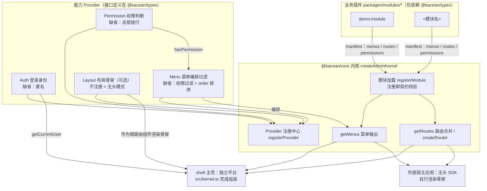
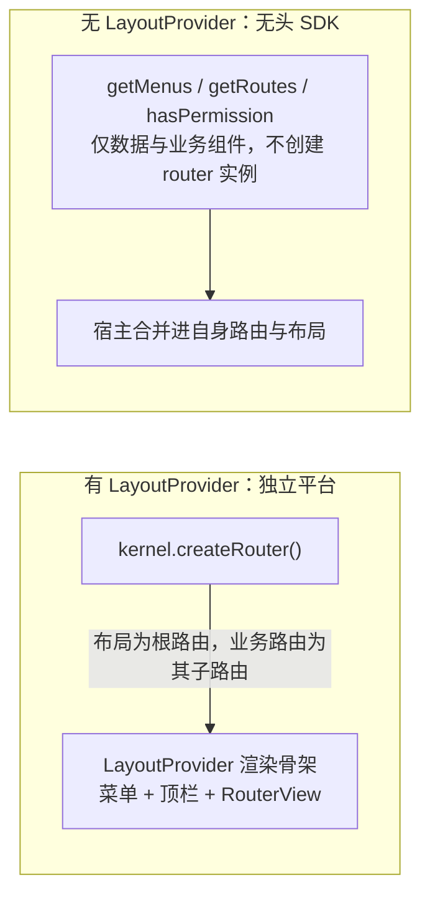

# kacean-admin

基于 pnpm monorepo 的后台管理系统：**shell 主壳 + 业务模块（modules）+ 公共包**。

## 环境要求

- Node.js >= 20
- pnpm 10.34.9（已由根 `package.json` 的 `packageManager` 锁定，推荐用 corepack 启用）

## 快速开始

```bash
pnpm install        # 根目录安装全部依赖
pnpm dev:shell      # 开发主壳应用
```

## 目录结构

```
packages/
├─ shell/              # 主壳应用（Vue 3 TSX + TDesign + UnoCSS，独立平台组装层）
├─ core/               # 内核 @kacean/core：模块加载、契约校验、Provider 注册中心（Auth/Permission/Menu/Layout）
├─ admin-module-types/ # 共享 TypeScript 类型定义（包名 @kacean/types）
├─ common/             # 共享通用逻辑（工具函数、常量等）
├─ shared-components/  # 共享 UI 组件
└─ modules/            # 业务插件模块：每一个文件夹都是一个独立模块
   ├─ demo-module/     # 示例模块模板：双产物（ESM + UMD）、独立开发壳
   └─ <模块名>/         # 可独立开发、独立构建
```

- 主壳与公共包：`packages/` 下固定为 `shell`、`core`、`admin-module-types`、`common`、`shared-components`。
- 业务模块：只放 `packages/modules/` 下，模块间互不依赖，共享能力使用公共包（`workspace:*`）。

## 内核与两种运行形态

### 架构图



### 两种形态的数据流



内核 `createAdminKernel()`（`@kacean/core`）负责模块加载、契约校验与 Provider 注册中心：

- `auth`：登录身份（缺省匿名）；`permission`：权限判断（缺省放行）；`menu`：菜单编排过滤（缺省内置实现）；`layout`：布局骨架（可选）。
- **独立平台**：shell 注册 TDesign `LayoutProvider`（`packages/shell/src/providers/TDesignLayout.tsx`），`kernel.createRouter()` 以布局为根路由。
- **无头 SDK**：不注册 `layout`，宿主仅消费 `getMenus()` / `getRoutes()` / `hasPermission()` / 业务组件，自行渲染骨架。

## 主题与 token

统一使用 TDesign token（`--td-*` CSS 变量），不另建自有 token 层——WC / UMD 嵌入下模块与宿主运行时本就分割，需要统一的只是视觉主题：

- **独立平台**：在 shell `src/styles/theme.css` 集中覆盖 `--td-*` 定制品牌主题。
- **无头嵌入**：宿主在自身样式表覆盖同名 `--td-*` 变量即可。CSS 自定义属性沿 DOM 继承，UMD 普通挂载直接生效；WC + Shadow DOM 下变量可穿透继承（模块样式表需注入 shadow root）；暗色模式由宿主同步挂载容器的 `theme-mode` 属性。
- **业务模块**：自定义样式只引用 `--td-*` 或 UnoCSS 语义原子类（`text-primary` / `bg-page` / `text-secondary` 等，见 `uno.config.ts` 的 theme 映射），禁止硬编码色值，保证宿主覆盖变量后整体跟随。

## 常用命令

| 命令                            | 说明         |
| ------------------------------- | ------------ |
| `pnpm dev:shell`                | 开发主壳     |
| `pnpm build:shell`              | 构建主壳     |
| `pnpm dev:module <模块名>`      | 开发指定模块 |
| `pnpm build:module <模块名>`    | 构建指定模块 |
| `pnpm lint`                     | 全仓 lint    |
| `pnpm format`                   | 全仓格式化   |
| `pnpm --filter shell typecheck` | 主壳类型检查 |

## 协作规范

人类与 AI agent 共用同一套规范，见 [AGENTS.md](./AGENTS.md)。
